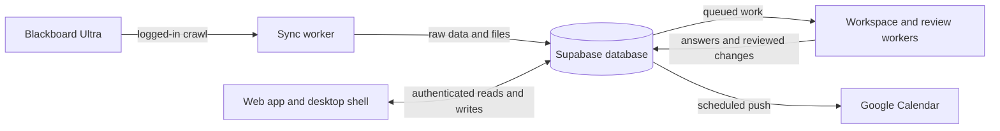

# bb2dash

Blackboard Ultra → Supabase → a personal academic hub. The web app brings course work, materials, grades, a planner and an assistant into one place.

Start with the [architecture guide](docs/architecture.md) for the system boundaries, three request flows and the source behind them. The [local Floorplan guide](docs/floorplan.md) explains how to open and maintain the interactive map. Its generated files stay local and out of git.

## Source guide

| Area | Where to start |
| --- | --- |
| Screens, browser data access and sign-in | [`web/src/`](web/src/), [`web/src/lib/supabase/`](web/src/lib/supabase/) |
| Blackboard capture and file extraction | [`sync/src/`](sync/src/), [`ingest/`](ingest/) |
| Schema, permissions and transforms | [`db/migrations/`](db/migrations/), [`DATA_SYNTAX.md`](DATA_SYNTAX.md) |
| Workspace answers and proposed planner changes | [`workspace/src/`](workspace/src/) |
| Inbox answers and announcement review | [`apply/src/`](apply/src/) |
| Uploaded document processing | [`workspace-ingest/src/`](workspace-ingest/src/) |
| Material retrieval and edge functions | [`mcp-server/`](mcp-server/), [`supabase/functions/`](supabase/functions/) |
| Desktop shell and container boundaries | [`desktop/`](desktop/), [`compose.yaml`](compose.yaml), [`docker/`](docker/) |

The architecture baseline is source commit `81d28019c3e3f10762b84507fe521df3fbd71c7a`. This is a code and documentation map, not a live production audit. It was built from a sparse analysis checkout that omits private files, credentials, course context, fixtures and decision logs. See the guide for the analysis limits.

Development happens on branches. Publishing, production changes and remote pushes require explicit authorization. Read [`CLAUDE.md`](CLAUDE.md) for the project workflow before operating the stack.
