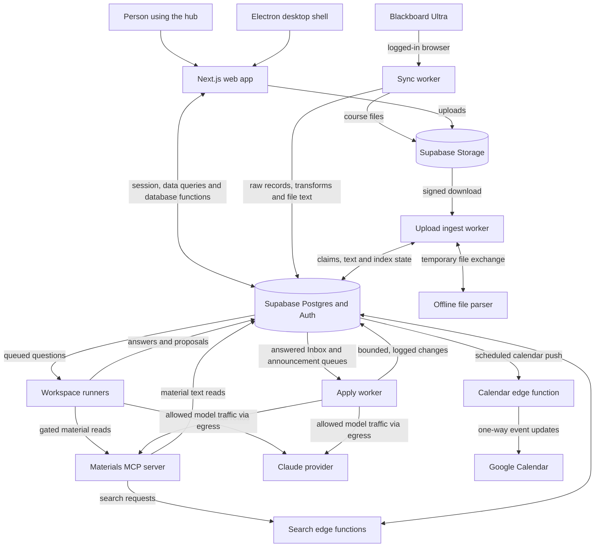
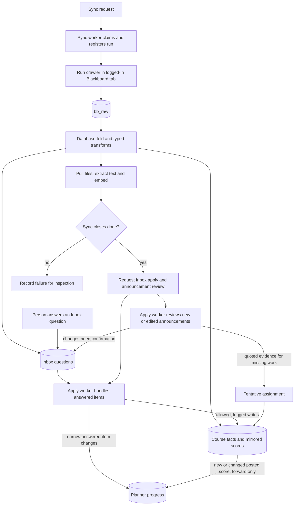
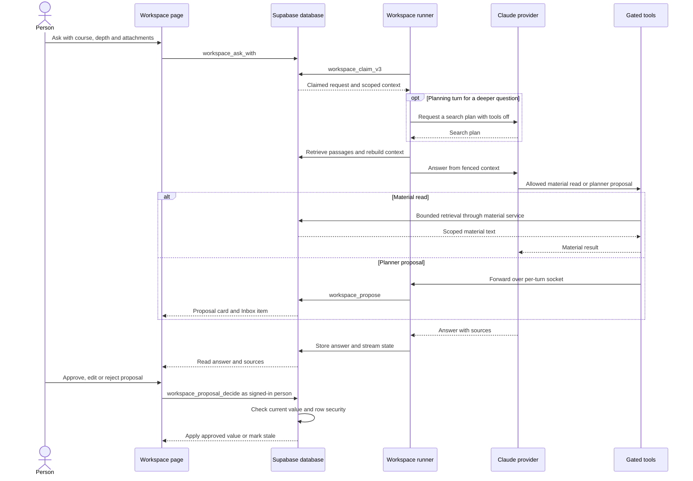

# Architecture guide

bb2dash copies course information from Blackboard into Supabase, then presents it in a web app and an Electron desktop shell. Background workers refresh the copy, answer Workspace questions and process review queues. The database keeps course facts separate from the person's planning choices.

This guide describes source commit `81d28019c3e3f10762b84507fe521df3fbd71c7a`. It explains the checked-in design, not the current state of production. The [Floorplan guide](floorplan.md) covers the local interactive map; the editable diagrams are in [diagrams/](diagrams/).

## The main parts

Source diagram: [system-overview.mmd](diagrams/system-overview.mmd).

| Part | Responsibility and source |
| --- | --- |
| Web app | Next.js screens under [`web/src/app/`](../web/src/app/), shared components and TanStack Query data hooks under [`web/src/lib/`](../web/src/lib/). |
| Desktop shell | [`desktop/`](../desktop/) hosts the web app and provides native integration. It does not replace the database or run the whole backend. |
| Database | [`db/migrations/`](../db/migrations/) defines tables, views, row security, queue functions and transforms. Supabase also supplies authentication, file storage and edge functions. |
| Capture | [`sync/src/loop.ts`](../sync/src/loop.ts) coordinates a logged-in browser crawl using [`ingest/bb_crawler.js`](../ingest/bb_crawler.js), waits for the database fold, then processes files and closes the run. |
| Assistance | [`workspace/src/`](../workspace/src/) answers queued questions. [`apply/src/`](../apply/src/) processes answered Inbox items and announcement reviews. |
| Uploaded files | [`workspace-ingest/src/`](../workspace-ingest/src/) downloads, verifies, extracts and indexes uploads, with a separate offline parser. |
| Material tools | [`mcp-server/src/server.ts`](../mcp-server/src/server.ts) exposes bounded material retrieval through Model Context Protocol (MCP). |
| Runtime boundaries | [`compose.yaml`](../compose.yaml) and [`docker/`](../docker/) define services, networks, mounts, secrets and egress controls. Host tooling lives in [`scripts/`](../scripts/). |

### Browser requests go directly to Supabase

The browser creates a Supabase client in [`client.ts`](../web/src/lib/supabase/client.ts). Query hooks read tables and views, call database functions through remote procedure calls (RPCs), and upload to Storage. For example, [`queries.workspace-ask.ts`](../web/src/lib/queries.workspace-ask.ts) calls `workspace_ask_with` directly. This is not a design in which every data request passes through a separate Next.js application programming interface server.

The Next.js [`proxy.ts`](../web/src/proxy.ts) delegates session refresh and sign-in redirects to [`proxy-session.ts`](../web/src/lib/supabase/proxy-session.ts). Database grants, function checks and row-level security (RLS) govern the actual data access. The browser's public Supabase key is not a substitute for those checks.

## Course facts and planner state

Course facts describe what the course or Blackboard reports: assignments, readings, dates, files, announcements and posted scores. Planner state records personal choices such as status, notes and planned start or finish. It lives chiefly in `assignment_progress` and `reading_progress`.

Sync must preserve planner choices. The important controlled exceptions and adjacent paths are:

- A newly posted or changed Blackboard score can advance an assignment to `graded`, forward only, preserving the excused and did not finish statuses.
- Inbox apply can make narrow changes supported by an answered Inbox item. Its role has a limited write surface and each write is recorded. It has no general permission to rewrite the planner.
- Workspace can propose supported changes. The signed-in owner calls `workspace_proposal_decide` to approve or reject; approval rechecks the current value under the person's row security before writing. A changed proposed field makes the proposal stale.
- Announcement review can add missing work as tentative with quoted evidence and ask about changes. It cannot write either progress table.

The contracts are in [`181_inbox_apply_runner_role.sql`](../db/migrations/181_inbox_apply_runner_role.sql), [`203_workspace_proposals.sql`](../db/migrations/203_workspace_proposals.sql), [`204_workspace_propose.sql`](../db/migrations/204_workspace_propose.sql), [`206_workspace_proposal_decide.sql`](../db/migrations/206_workspace_proposal_decide.sql) and [`211_announcement_reader_functions.sql`](../db/migrations/211_announcement_reader_functions.sql). Status names are centralized in [`progress-status.ts`](../web/src/lib/progress-status.ts).

## A sync and its review queues

Source diagram: [sync-and-review.mmd](diagrams/sync-and-review.mmd).

The crawler running in the Blackboard browser sends raw observations to `bb_raw` through Supabase's browser-facing intake. [`002_raw_landing.sql`](../db/migrations/002_raw_landing.sql#L16) grants anonymous insert access to that landing table. The worker's orchestration login is a separate boundary: it uses a dedicated database role through named functions, rather than a general table login; see [`sync/src/db.ts`](../sync/src/db.ts) and [`091_sync_runner_role.sql`](../db/migrations/091_sync_runner_role.sql). [`136_transform_tick_register_first.sql`](../db/migrations/136_transform_tick_register_first.sql#L80) checks registered runs before folding raw observations into typed records. These checks constrain the fold while the anonymous raw intake remains present in source.

Database transforms reconcile the observations into typed tables. The file stage stores course files, extracts text and runs embedding work. This path contains no language-model review.

Only after a successful close does [`sync/src/loop.ts`](../sync/src/loop.ts) request Inbox apply and announcement review. A failure to enqueue either follow-up is logged separately and does not change the already closed sync's result.

The [`apply` loop](../apply/src/loop.ts) takes Inbox requests first. It handles simple records itself and sends the remaining bounded batch to a Claude CLI run. Held answers wait for a new answer or an explicit retry. When Inbox work is idle, [`announcement-pass.ts`](../apply/src/announcement-pass.ts) handles the announcement queue. The announcement record function validates evidence and logs writes. [`212_bind_announcement_rows.sql`](../db/migrations/212_bind_announcement_rows.sql) and [`223_announcement_dates_ask.sql`](../db/migrations/223_announcement_dates_ask.sql) govern later gradebook binding and questions about conflicting dates or points.

## A Workspace question and a planner proposal

Source diagram: [workspace-request.mmd](diagrams/workspace-request.mmd).

The request is a database queue entry. The two declared runner services claim through `workspace_claim_v3`; the database caps concurrency and prevents simultaneous requests in one conversation. [`runner.ts`](../workspace/src/runner.ts), [`turn.ts`](../workspace/src/turn.ts) and [`prepare.ts`](../workspace/src/prepare.ts) separate claiming, turn lifecycle and context preparation.

Each turn rebuilds its context from database records: recent conversation, summary, retrieved passages, attachments and a bounded planner/grades feed. Context blocks are fenced as data. A deeper question can use a cheap planning turn before retrieval; the answering turn then uses a selected Claude model. [`providers/index.ts`](../workspace/src/providers/index.ts) connects the Claude CLI provider. The frontier API and Ollama providers in this baseline are stubs, not working alternative integrations.

The tool gate permits scoped material reads and `propose_planner_change`. Planning and summary turns receive no MCP servers. The planner MCP process has no database credential; it forwards proposals over a per-turn socket to the runner. [`mcp-config.ts`](../workspace/src/mcp-config.ts), [`hooks/gate-rules.ts`](../workspace/src/hooks/gate-rules.ts) and [`propose/`](../workspace/src/propose/) define those limits.

`workspace_propose` checks the claimed request and permitted fields, then records a proposal and an `assistant_proposal` Inbox item. This item stays outside ordinary Inbox apply. The card below an answer and the Inbox use the same [`queries.workspace-proposals.ts`](../web/src/lib/queries.workspace-proposals.ts) decision function. Approval can include an edited value; the database retains both the original proposal and the approved value. Rejection, expiry and stale-target checks are part of the proposal lifecycle.

## Uploads, material retrieval and outbound access

An upload goes from the browser to Supabase Storage and a document row. [`process-document.ts`](../workspace-ingest/src/process-document.ts) downloads it through a signed URL, checks its bytes, stores extracted text and resumes embedding work as needed. [`compose.yaml`](../compose.yaml) declares `workspace-extract` without a network or secrets. It exchanges temporary files with `workspace-ingest` through a memory-backed temporary volume (tmpfs). Neither upload service shares the Blackboard browser's profile volume with the sync worker.

The database stores course text and vectors in `bb_file_text` and `bb_text_embeddings`, and Workspace document text and vectors in `workspace_document_text` and `workspace_text_embeddings`. Search combines text and vector retrieval. Course embedding work lives in [`embed-corpus`](../supabase/functions/embed-corpus/); uploaded-document embedding and search live in [`workspace-embed`](../supabase/functions/workspace-embed/) and [`workspace-search`](../supabase/functions/workspace-search/). [`mcp-server/src/server.ts`](../mcp-server/src/server.ts) registers `search_materials`, `get_material_text` and `list_courses` for callers with the appropriate configuration.

The restricted `workspace_runner` login has function permissions rather than general table grants. That statement does not mean the entire container lacks a more powerful credential: the materials package consumes a service key through [`mcp-server/src/client.ts`](../mcp-server/src/client.ts), behind its bounded read-only tool interface. Keep that distinction when assessing trust boundaries.

The Compose design routes Workspace, apply and upload-ingest internet traffic through [`docker/egress/`](../docker/egress/) with separate ports and allow-lists. Workspace and apply allow the model service and the project host; upload ingest allows only the project host. The offline parser has no such outbound path. This is a description of the checked-in network and firewall design, not a verification of running container rules.

## Calendar output

The calendar flow is push-only. A database tick invokes [`calendar-push`](../supabase/functions/calendar-push/index.ts) using a dedicated shared-secret header. The function reads desired assignment and planner events, compares them with its mirror, and inserts, updates or removes events on a dedicated Google calendar. It does not import Google changes into the planner. The scheduler and planner-event arm are defined in [`062_calendar_push_tick.sql`](../db/migrations/062_calendar_push_tick.sql) and [`068_calendar_push_planner_arm.sql`](../db/migrations/068_calendar_push_planner_arm.sql).

## Reading the interactive map

The map groups the hub, capture, assistance, database, operational tools and checks, plus outside systems. Follow the tour first, then the sync or Workspace flow. Database queues, RPC calls, scheduled jobs and service boundaries require explicit map edges because a JavaScript import graph cannot show them all.

The initial scan detected no HTTP route definitions or matched HTTP calls. That does not mean the app has no remote interfaces: Supabase RPCs, table access, edge functions, browser automation and stdio MCP calls remain real boundaries. The Next.js page tree and query modules are better references for the user-facing screens and database calls than automatic route counts.

Floorplan's Health view is a static heuristic. It can flag an old SQL grant or policy without reconstructing every later migration, or miss a function-level permission check. The baseline's specific findings and retained raw-intake boundary are [triaged in the Floorplan guide](floorplan.md#health-review-at-this-baseline). Treat findings as review leads and inspect the owning source before drawing a security conclusion. Neither this map nor the diagrams establish the live database schema, grants, network enforcement or deployed service versions.

The analysis checkout deliberately omits credential and agent configuration, private material, course context, harness data, caches, fixtures, database fixtures and Inbox decision logs. Those omissions reduce coverage and are not evidence that the omitted areas are empty or unimportant. No live database, Blackboard account, model service or Google calendar was queried for this documentation pass.
